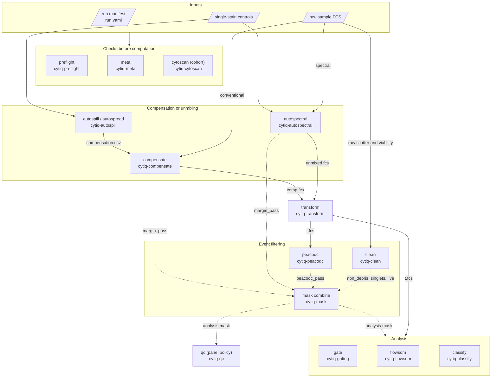

# cytiq

Rust workspace for flow-cytometry tooling: FCS I/O, compensation and spectral
unmixing, event filtering, quality control, gating, clustering and classification.

## Pipeline

Solid arrows carry FCS files and matrices; dotted arrows carry
[per-event masks](crates/cytiq-mask/README.md).



See the [pipeline guide](crates/cytiq-cli/PIPELINE.md) for a complete command
chain and signal-state checks.

## Repository layout

- [`crates/cytiq-cli/`](crates/cytiq-cli/README.md) — the `cytiq` binary; argument parsing and command dispatch.
- [`crates/cytiq-*/`](crates/) — library crates with reusable algorithms and workflows.
- [`data/fixtures/`](data/fixtures/) — synthetic test data and reference outputs; dataset READMEs describe their contents and generation.
- [`parity/`](parity/) — validation against upstream R/Python tools.
- [`docker/Dockerfile`](docker/Dockerfile) — container build.

Each crate has a `README.md` for usage and public APIs, and a `CONTRIBUTING.md`
for implementation details and invariants. New binaries and libraries belong
under `crates/`.

## Documentation

- [CLI commands and shared conventions](crates/cytiq-cli/README.md)
- [Pipeline, stage order and signal-state checks](crates/cytiq-cli/PIPELINE.md)
- [Papers and upstream implementations](CITATIONS.md)
- [Contributor guidelines](CONTRIBUTING.md)

## Development

Requires stable Rust (edition 2024), Cargo, `rustfmt`, Clippy and `just`.
Linux builds also need a C++ toolchain such as `g++`. The first build needs
HTTPS access to download ONNX Runtime; it is linked statically into `cytiq`.
See [classification build details](crates/cytiq-classify/README.md).

```bash
just build              # debug workspace build
just run --help         # run the CLI from source
just build-release      # optimized binary: target/release/cytiq
just test               # workspace tests
just verify             # format, cargo check, Clippy and tests
```

Run `just verify` before opening a pull request. Use `just --list` for all
recipes, or target one crate with `cargo test -p cytiq-fcs`.

## Algorithm validation

For changes that can affect scientific results, run both parity suites locally.
Setup requires R and `uv` and creates an isolated environment in `parity/.env`:

```bash
just parity-setup       # once: install upstream R/Python tools
just parity             # synthetic datasets
just parity-real        # real acquisitions
```

Results and known differences are in [`parity/REPORT.md`](parity/REPORT.md);
[real-data documentation](parity/real/README.md) covers dataset sources.
Violations of [`parity/tolerances.json`](parity/tolerances.json) or
[`parity/real/tolerances.json`](parity/real/tolerances.json) fail the run.

CI runs the Rust quality checks, tests and Docker checks. It validates the
[end-to-end pipeline](data/fixtures/pipeline/README.md) and
[upstream parity smoke fixtures](data/fixtures/parity/README.md) without R;
the full parity suites run locally. Regenerate reference fixtures only for
intentional generator, dataset or upstream-version changes; see
[CONTRIBUTING.md](CONTRIBUTING.md).

## Docker

```bash
just docker-build
docker run --rm --user "$(id -u):$(id -g)" -v "$PWD:/data" cytiq:dev autospill \
  --controls data/fixtures/autospill/controls.csv \
  --input-dir data/fixtures/autospill --output compensation.csv
```

The image runs as an unprivileged user (UID 10001), with `/data` as its working
directory. `--user` makes outputs in the mounted directory belong to you.
